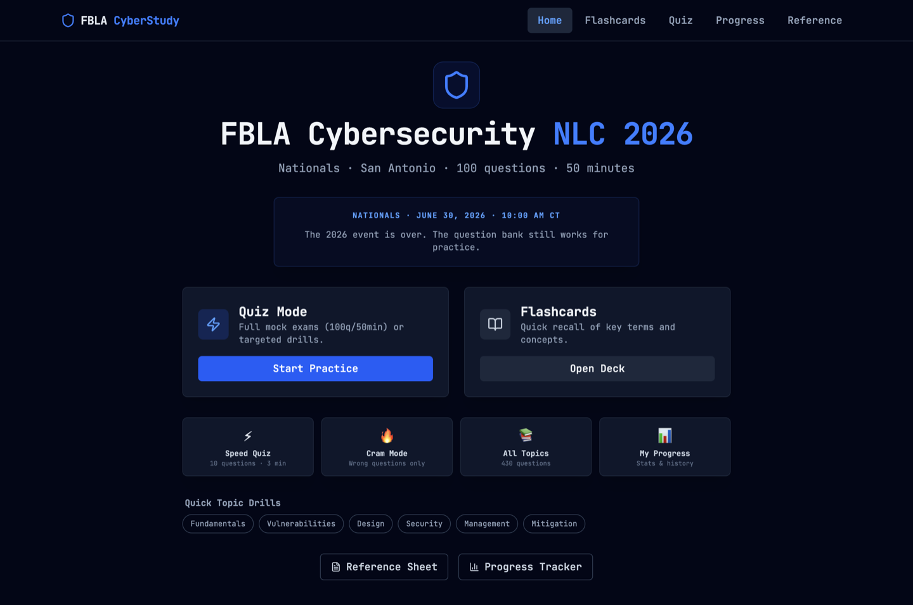
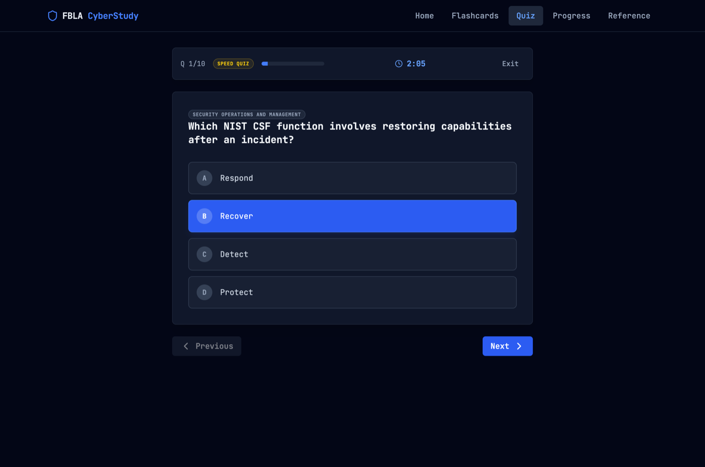

# FBLA Cybersecurity Study App

A study app I built to prepare for the FBLA Cybersecurity objective test at the 2026 National Leadership Conference: 430 practice questions, 143 flashcards, timed mock exams, and a one-page reference sheet.

Live: https://tundra-node.github.io/fbla-cybersecurity-2026/



## Why

The Cybersecurity event is a 100 question, 50 minute multiple choice test. Most of the prep material I found was either a list of terms or scattered PDFs. I wanted one place to drill questions under a real time limit, keep track of which topics I kept missing, and go back over only the questions I got wrong.

## Features

- **Mock exam**: 100 random questions in 50 minutes, matching the real test format.
- **Speed quiz**: 10 questions in 3 minutes.
- **Topic drills**: 20 questions from one or more of the six test categories.
- **Weak areas drill**: picks your two lowest scoring categories.
- **Cram mode and wrong answer bank**: every missed question is saved and can be drilled until you get it right.
- **Instant feedback (optional)**: shows the explanation after each answer.
- **Flashcards**: mark cards as known or still learning. Cards you miss come back a few cards later.
- **Reference sheet**: condensed notes for all six categories (TCSEC and the Rainbow Series, historical malware, ports, crypto, laws, incident response, risk formulas, and more).
- **Progress tracker**: accuracy per category, session history, best streak, and export or import of your progress as JSON.
- Answer order is shuffled every time, so you learn the answer and not its position.
- Everything is stored in your browser's localStorage. No account, no server.



## Quick start

Requires Node.js 18 or newer (CI uses Node 22).

```bash
git clone https://github.com/tundra-node/fbla-cybersecurity-2026.git
cd fbla-cybersecurity-2026
npm ci
npm run dev
```

Open http://localhost:3000/fbla-cybersecurity-2026/

| Command | What it does |
|---|---|
| `npm run dev` | Dev server on port 3000 |
| `npm run lint` | Type check with `tsc --noEmit` |
| `npm run build` | Production build into `dist/` |
| `npm run preview` | Serve the production build on port 4173 |

To study without internet, see [OFFLINE.md](OFFLINE.md).

There are no environment variables or API keys.

## Deployment

Every push to `main` runs `.github/workflows/deploy.yml`, which type checks, builds, and publishes `dist/` to GitHub Pages. `dist/` is not committed. The Vite `base` is `/fbla-cybersecurity-2026/`, so if you fork it under another repo name, change `base` in `vite.config.ts` and the URLs in `index.html`.

## Project layout

```
src/
  App.tsx        all views: home, quiz, results, flashcards, progress, reference sheet
  data.ts        question bank and flashcards
  main.tsx       entry point
  index.css      Tailwind import and theme
  lib/utils.ts   class name helper
public/          favicon and social preview image
docs/            README screenshots
study-plan.html  standalone 5 day study plan page (not part of the build)
OFFLINE.md       offline setup
```

### Adding questions

Questions live in `src/data.ts`. Each one has an `id`, a `category` from `CATEGORIES`, four `options`, the index of the right answer in `correctAnswer`, and an `explanation`. Options are shuffled at display time, so you can put the right answer anywhere.

## Content accuracy

The questions were checked for obvious factual errors in October 2026, and several were fixed (TCSEC levels, Rainbow Series colors, backup types, Code Red II, SaaS responsibilities, and others). Many of the "NLC" questions still have a placeholder explanation. If you find a wrong answer, open an issue.

This is an unofficial study aid and is not affiliated with or endorsed by FBLA.

## AI usage

AI tools were used while building this. A later cleanup pass (fact checking the question bank, fixing quiz timer and progress bugs, and writing this README and OFFLINE.md) was done with an AI coding agent and reviewed by me.

## License

MIT. See [LICENSE](LICENSE).
